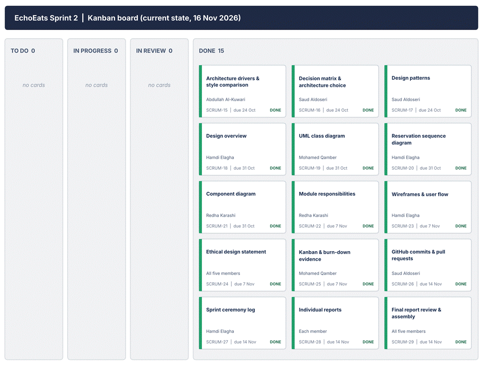
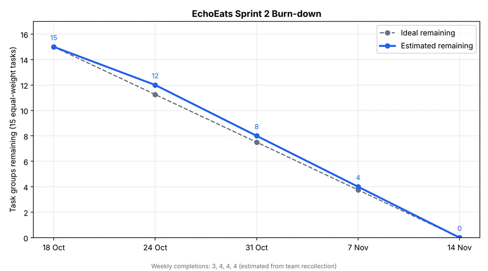

# Sprint 2 Kanban and burn-down evidence

Owner: Mohamed Qamber. Tasks: SCRUM-19 and SCRUM-25.

## Files

- `uml-class-diagram.png`: original UML class diagram extracted from the team report.
- `kanban-16-nov-2026.gif`: original final Kanban board image from the report.
- `sprint2-burndown.gif`: original burn-down chart from the report.

## Sprint start — 18 October 2026

To do: 15; In progress: 0; Done: 0. All SCRUM-15 through SCRUM-29 cards were in To do.

## Sprint middle — 31 October 2026

| To do (4) | In progress (4) | Done (7) |
| --- | --- | --- |
| SCRUM-26 GitHub commits & pull requests — Saud | SCRUM-22 Module responsibilities — Redha | SCRUM-15 Architecture drivers & style comparison — Abdullah |
| SCRUM-27 Sprint ceremony log — Hamdi | SCRUM-23 Wireframes & user flow — Hamdi | SCRUM-16 Decision matrix & architecture choice — Saud |
| SCRUM-28 Individual reports — Each | SCRUM-24 Ethical design statement — All | SCRUM-17 Design patterns — Saud |
| SCRUM-29 Final report review & assembly — All | SCRUM-25 Kanban & burn-down evidence — Mohamed | SCRUM-18 Design overview — Hamdi |
| | | SCRUM-19 UML class diagram — Mohamed |
| | | SCRUM-20 Reservation sequence diagram — Hamdi |
| | | SCRUM-21 Component diagram — Redha |

## Final board — 16 November 2026

The board image in the report shows all 15 cards as Done, with zero in To do, In progress, and In review.

## Burn-down

Sprint dates: 18 October–14 November 2026. Fifteen equal-weight task cards.
The report labels the remaining task counts as estimates from team recollection; these are not an exported Jira history.

| Checkpoint | Ideal remaining | Estimated remaining |
| --- | ---: | ---: |
| 18 October | 15 | 15 |
| 24 October | 11.25 | 12 |
| 31 October | 7.5 | 8 |
| 7 November | 3.75 | 4 |
| 14 November | 0 | 0 |

Source: the team's Name_FINAL.docx report, UML class diagram and Agile Artifacts Summary sections.
